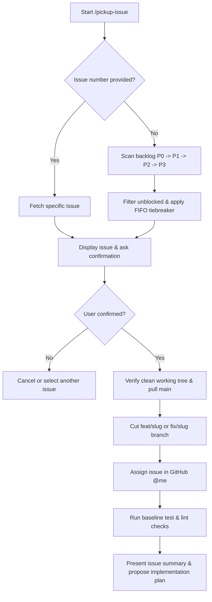

# Pickup Issue

This skill guides an agent to select, claim, and set up a workspace for the highest priority unblocked GitHub backlog issue (or a user-specified issue number), following repo branching and quality conventions.

## Workflow Overview



---

## Step 1: Issue Selection

### If an issue number is provided (e.g. `/pickup-issue 42`)
Fetch the issue details directly:
```bash
gh issue view <number> --json number,title,labels,body,state,assignees,url
```
- Ensure the issue is `OPEN`.
- Check if it contains the `needs-db` label. If present, verify with the user:
  > "Issue #<number> has `needs-db`. Has the required SQL migration been run on the live database?"
  Do not proceed until the user confirms.

### If no issue number is provided (auto-priority search)
Search for the highest priority unblocked issue in the backlog:
1. Search priority tiers in strict order: `P0` -> `P1` -> `P2` -> `P3`:
   ```bash
   gh issue list --label backlog --label P0 --state open --json number,title,labels,createdAt --limit 10
   ```
2. If `P0` has no open issues, check `P1`:
   ```bash
   gh issue list --label backlog --label P1 --state open --json number,title,labels,createdAt --limit 10
   ```
   Continue to `P2`, then `P3` if higher tiers are empty.
3. **Filter blocked issues**:
   - Skip any issue with `needs-db` unless the user explicitly confirms the database change has been applied.
   - Skip issues already assigned to someone else unless the user directs otherwise.
4. **Tiebreak (FIFO)**:
   - When multiple issues exist in the same highest priority tier, select the **oldest first** (lowest issue number / earliest `createdAt`).
5. Fetch the full issue body:
   ```bash
   gh issue view <number> --json number,title,labels,body,url
   ```

---

## Step 2: Confirmation Gate

Present the candidate issue to the user:
- **Number & Title**: `#<number>: <title>`
- **Labels**: `backlog`, `P<n>`, `bug` / `enhancement`, etc.
- **Issue Summary**: Key lines from the body (`Story`, `Where`, `Done when`, `DB change`).
- **Proposed Branch**: `fix/<slug>` (if bug) or `feat/<slug>` (if enhancement).

Ask for confirmation before altering git state:
> "Would you like me to pick up **#<number>: <title>** on branch `<prefix>/<slug>`?"

---

## Step 3: Workspace & Branch Setup

Once confirmed:
1. **Check working directory cleanliness**:
   ```bash
   git status --porcelain
   ```
   If there are uncommitted changes, stop and ask the user to commit, stash, or discard them first.
2. **Switch to main and pull latest**:
   ```bash
   git checkout main && git pull origin main
   ```
3. **Determine branch slug**:
   - Prefix: `fix/` for `bug`, `feat/` for `enhancement`, or `chore/` / `refactor/` as appropriate.
   - Slug: Short, kebab-case descriptor derived from the issue title (e.g., `fix/offline-sync-queue`).
4. **Create and checkout branch**:
   ```bash
   git checkout -b <prefix>/<slug>
   ```
5. **Assign the issue on GitHub**:
   ```bash
   gh issue edit <number> --add-assignee "@me"
   ```

---

## Step 4: Baseline Quality Verification

Run baseline quality checks to ensure a clean starting point:
```bash
npm test
npm run lint
```
If baseline checks fail, notify the user immediately with the exact failure output before writing any code.

---

## Step 5: Planning Handover

Conclude the pickup phase by summarizing the work and proposing next steps:
1. Restate the exact acceptance criteria from `Done when`.
2. Pinpoint the files and lines identified in `Where`.
3. Propose a reproduction test or TDD strategy.
4. Present an implementation plan outline and wait for user guidance before modifying code.
