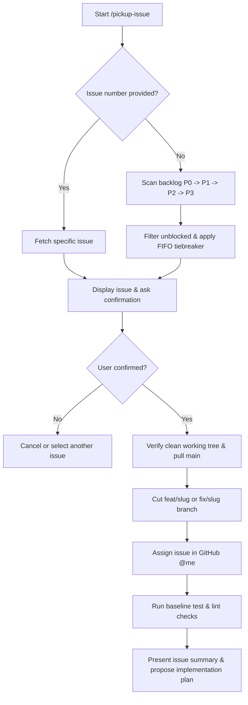

# Pickup Issue

This skill guides an agent to select, claim, and set up a workspace for the highest priority unblocked GitHub backlog issue (or a user-specified issue number), following repo branching and quality conventions.

## Workflow Overview



---

## Step 1: Issue Selection

### If an issue number is provided (e.g. `/pickup-issue 42`)
Fetch the issue details directly:
```bash
gh issue view <number> --json number,title,labels,body,state,assignees,url
```
- Ensure the issue is `OPEN`.
- Check if it contains the `needs-db` label. If present, verify with the user:
  > "Issue #<number> has `needs-db`. Has the required SQL migration been run on the live database?"
  Do not proceed until the user confirms.

### If no issue number is provided (auto-priority search)
Search for the highest priority unblocked issue in the backlog:
1. Search priority tiers in strict order: `P0` -> `P1` -> `P2` -> `P3`:
   ```bash
   gh issue list --label backlog --label P0 --state open --search "no:assignee" --json number,title,labels,createdAt,assignees --limit 10
   ```
2. If `P0` has no open issues, check `P1`:
   ```bash
   gh issue list --label backlog --label P1 --state open --search "no:assignee" --json number,title,labels,createdAt,assignees --limit 10
   ```
   Continue to `P2`, then `P3` if higher tiers are empty.
3. **Filter blocked & in-progress issues**:
   - **Skip already assigned issues**: Skip any issue with assignees (`assignees.length > 0`), including issues assigned to yourself (`@me`). Any assigned issue has already been picked up.
   - Skip any issue with `needs-db` unless the user explicitly confirms the database change has been applied.
4. **Tiebreak (FIFO)**:
   - When multiple issues exist in the same highest priority tier, select the **oldest first** (lowest issue number / earliest `createdAt`).
5. Fetch the full issue body:
   ```bash
   gh issue view <number> --json number,title,labels,body,url
   ```

---

## Step 2: Confirmation Gate

Present the candidate issue to the user:
- **Number & Title**: `#<number>: <title>`
- **Labels**: `backlog`, `P<n>`, `bug` / `enhancement`, etc.
- **Issue Summary**: Key lines from the body (`Story`, `Where`, `Done when`, `DB change`).
- **Proposed Branch**: `fix/<slug>` (if bug) or `feat/<slug>` (if enhancement).

Ask for confirmation before altering git state:
> "Would you like me to pick up **#<number>: <title>** on branch `<prefix>/<slug>`?"

**`--express`** (see `docs/agent-workflow.md` §A): if an explicit issue number was passed, that counts as confirmation, so skip this question. Otherwise ask it once for the proposed issue. `needs-db` confirmation is still required.

---

## Step 3: Workspace & Branch Setup

Once confirmed:
1. **Check working directory cleanliness**:
   ```bash
   git status --porcelain
   ```
   If there are uncommitted changes, stop and ask the user to commit, stash, or discard them first.
2. **Switch to main and pull latest**:
   ```bash
   git checkout main && git pull origin main
   ```
3. **Determine branch slug**:
   - Prefix: `fix/` for `bug`, `feat/` for `enhancement`, or `chore/` / `refactor/` as appropriate.
   - Slug: Short, kebab-case descriptor derived from the issue title (e.g., `fix/offline-sync-queue`).
4. **Create and checkout branch**:
   ```bash
   git checkout -b <prefix>/<slug>
   ```
5. **Assign the issue on GitHub**:
   ```bash
   gh issue edit <number> --add-assignee "@me"
   ```

---

## Step 4: Baseline Quality Verification

Run baseline quality checks to ensure a clean starting point:
```bash
bash scripts/check.sh lint test
```
(Prints one PASS/FAIL line per step, with the tail of the log only on failure.) If baseline checks fail, notify the user immediately with the exact failure output before writing any code.

---

## Step 5: Planning Handover

Conclude the pickup phase by summarizing the work and proposing next steps:
1. Restate the exact acceptance criteria from `Done when`.
2. Pinpoint the files and lines identified in `Where`.
3. Propose a reproduction test or TDD strategy.
4. Present an implementation plan outline and wait for user guidance before modifying code.

---

## Step 6: Express Finish (only with `--express`)

Without `--express`, stop after Step 5. With it, skip the wait in Step 5 and run through to an open PR, for this invocation only:

1. Implement the issue (TDD where practical), keeping the diff minimal.
2. Run `npm run check` (plus `npm run test:e2e` if UI flows changed). On any failure, stop and report; never use `--no-verify` or disable tests.
3. Commit with a conventional message, then push the branch. Never touch `main`; never force-push.
4. If the UI changed, capture before/after screenshots and push them to `chore/pr-screenshots` per agent-workflow §G (no personal data).
5. Open the PR with `gh pr create`: what changed, why, how verified, `Closes #<number>`.
6. Stop. Never merge. Report the PR URL, a checks summary, and an audit trail of what was done unprompted (commit message, branch pushed, screenshots).

---

## Session Hygiene (token budget)

- One issue per session. Start a fresh session for the next issue or PR; use `/clear` between unrelated tasks.
- Once context passes about 100k tokens, run `/compact` or restart with a short handoff note.
- Effort: `low` for chore branches (formatting, lint sweeps, issue filing), `medium` otherwise.
- Models: Opus only for planning and final review, Sonnet for implementation, Haiku for searches and running checks. When spawning subagents set `model` explicitly and avoid `fork`, which inherits the parent model.
- Run checks through `npm run check` (or `scripts/check.sh`) to keep output short.
