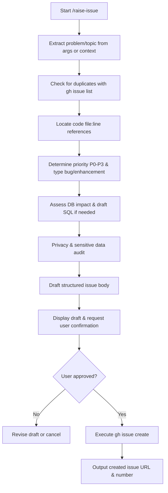

# Raise Issue

This skill guides an agent through analyzing, drafting, privacy-auditing, and raising a new GitHub issue in accordance with repo backlog standards (AGENTS.md Section 7.H).

## Workflow Overview



---

## Step 1: Gather Topic & Context

1. If an argument is provided (e.g. `/raise-issue sync error when session expires`), use it as the core subject.
2. If omitted, extract the topic from recent conversation context (e.g., an unhandled edge case or bug discovered during another task).
3. Confirm with the user if the topic is ambiguous.

---

## Step 2: Initial Analysis

Perform the following verification steps before drafting:

### 1. Duplicate Check
Search existing open and recently closed issues to avoid duplicate entries:
```bash
gh issue list --search "<keywords>" --state all --json number,title,state,url
```
If an existing issue covers this topic, link it and ask the user if an update or comment is preferred instead of opening a duplicate.

### 2. Codebase Inspection (`Where`)
Inspect the repository to identify specific file paths and line numbers:
- Use targeted grep or file reads to find the exact component, function, or handler.
- Note the location in `path/to/file.ts:line` format.

### 3. Priority Assessment (`P0` - `P3`)
Classify the issue strictly by priority guidelines:
- **`P0`**: Money or data is wrong (e.g., incorrect balance calculations, corrupted financial records).
- **`P1`**: Something is broken or blocks a user flow (e.g., failed transaction submission, broken navigation).
- **`P2`**: Friction or polish (e.g., awkward layout wrapping, confusing copy, UI glitch).
- **`P3`**: Ideas, non-critical enhancements, or tech debt backlog.

### 4. Issue Type Classification
- Label as `bug` if it is unintended or broken behavior.
- Label as `enhancement` if it is a new capability or improvement.

### 5. Database Impact Assessment
- Check if database migrations, RLS policies, tables, or seed changes are required.
- If a live DB change is needed:
  - Add the `needs-db` label.
  - Draft the exact SQL statement required in the `DB change:` field.
- If no DB change is needed, set `DB change: none`.

### 6. Public Repo Privacy Audit (Mandatory)
> [!CAUTION]
> This repository is public. Never include real personal names, real account balances, actual salaries, email addresses, API secrets, or private environment variables in the issue title or body. Use mock/placeholder examples only.

---

## Step 3: Format the Issue

Structure the issue body strictly according to AGENTS.md Section 7.H:

```markdown
Story: As a <who>, I want <what>, so that <why>.
Where: <file:line>
Done when: <acceptance criteria>
Refs: <plan, audit ID, or related PR/issue, or none>
DB change: <none, or the SQL the user must run>
```

### Title Convention
- Keep titles concise, functional, and prefixed with standard type conventions:
  - `fix(<scope>): <short description>`
  - `feat(<scope>): <short description>`
  - `refactor(<scope>): <short description>`

### Labels
- Always include `backlog`.
- Always include exactly one priority label: `P0`, `P1`, `P2`, or `P3`.
- Always include `bug` or `enhancement`.
- Include `needs-db` if a database migration or SQL is required.

---

## Step 4: Confirmation Gate

Present the full draft to the user for review:

```markdown
### Proposed Issue Draft
- **Title**: `...`
- **Labels**: `backlog`, `P<n>`, `bug|enhancement` (and `needs-db` if applicable)
- **Body**:
  Story: As a ...
  Where: ...
  Done when: ...
  Refs: ...
  DB change: ...
```

Explicitly ask for confirmation before posting:
> "Would you like me to create this issue on GitHub?"

---

## Step 5: Create the Issue

Once the user approves:
```bash
gh issue create \
  --title "<title>" \
  --label "backlog" \
  --label "<P0|P1|P2|P3>" \
  --label "<bug|enhancement>" \
  [--label "needs-db"] \
  --body "<body_content>"
```

Output the created issue URL and issue number for reference.
