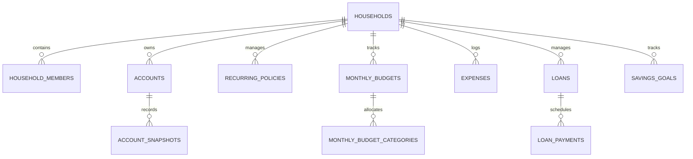

# Budget Buddy: Couple & Personal Finance Web App — Design Specification

**Date**: 2026-09-15  
**Status**: Approved (Brainstorming Complete)  
**Authors**: Antigravity & Yi Jia  
**Target Stack**: React 19, Vite, Tailwind CSS, Supabase (PostgreSQL, Auth, RLS), Vercel Hosting (Public GitHub Repository)

---

## 1. Executive Summary & Goals

### 1.1 Objective
Build a modern, high-performance web application and installable PWA for **Yi Jia** and **Rachel** to manage their personal budgets and combined couple finances. The application directly replaces and surpasses their existing Notion finance workspace (`Combined Finances`, `Yi Jia's Budget`, and `Rachel's Budget`), eliminating Notion's key limitations:
- **No manual relational plumbing**: Eliminates the need to create separate relational properties for every single category and budget row.
- **Automated monthly roll-overs**: Replaces manual "Sync" buttons and brittle multi-line date formulas with automated template-based monthly budget initialization.
- **Native financial engines**: Implements mathematically exact loan amortization, compound interest tracking, and lump-sum prepayment simulations (replacing Notion's WIP loan formula).
- **Couple expense sharing & settlement**: Introduces seamless shared expense logging with automatic 50/50 (or custom) splitting and a running "Who owes whom / Settle up" balance tracker.
- **Mobile-first speed**: Enables sub-second expense logging on smartphones with a dedicated Quick Add modal and PWA home-screen support.
- **True Net Worth**: Unifies asset account balances (Cash, Investments, CPF OA/SA/MA) with outstanding liabilities (HDB loan) to compute real Net Worth ($Assets - Liabilities$).

### 1.2 GitHub & Vercel Security Architecture
- **Public Repository Safety**: The codebase will be publicly hosted on GitHub and automatically deployed to Vercel upon pushing to the `master` branch.
- **Zero Financial Leakage**: Real bank balances, account numbers, and personal identifiers will **never** be committed to Git.
- **Gitignore Strategy**: `.env`, `.env.local`, and private seed SQL scripts (`seed.private.sql`) are strictly ignored.
- **Dual-Mode Data Access Layer**:
  - **Live Mode**: When `VITE_SUPABASE_URL` and `VITE_SUPABASE_ANON_KEY` are provided in Vercel or `.env.local`, the app interacts with Supabase PostgreSQL via Row-Level Security (RLS).
  - **Mock / Demo Preview Mode**: If Supabase credentials are not yet configured, the app seamlessly runs against an in-memory/localStorage store pre-seeded with realistic anonymized data, allowing instant zero-setup local previews.

---

## 2. Database Schema & Supabase Architecture

All tables reside in PostgreSQL with Row-Level Security (RLS) enabled. Data is partitioned by `household_id`.



### 2.1 Table Definitions (DDL Summary)

#### `households`
- `id` (uuid, PK, default `gen_random_uuid()`)
- `name` (text, not null) — e.g. "Yi Jia & Rachel"
- `currency` (text, default `'SGD'`)
- `created_at` (timestamptz, default `now()`)

#### `household_members`
- `id` (uuid, PK, default `gen_random_uuid()`)
- `household_id` (uuid, FK -> `households.id` ON DELETE CASCADE)
- `user_id` (uuid, nullable, FK -> `auth.users.id` ON DELETE CASCADE)
- `display_name` (text, not null) — e.g. "Yi Jia", "Rachel"
- `email` (text, nullable)
- `role` (text, default `'member'`) — `'owner'` | `'member'`
- `avatar_url` (text, nullable)
- `created_at` (timestamptz, default `now()`)

#### `accounts` (Assets)
- `id` (uuid, PK, default `gen_random_uuid()`)
- `household_id` (uuid, FK -> `households.id` ON DELETE CASCADE)
- `owner_id` (uuid, FK -> `household_members.id` ON DELETE CASCADE)
- `name` (text, not null) — e.g. "OCBC 360", "SGX CDP", "CPF OA", "UOB One"
- `type` (text, not null) — `'Cash'` | `'Investment'` | `'CPF'` | `'Other'`
- `balance` (numeric(12, 2), not null default 0.00)
- `currency` (text, default `'SGD'`)
- `institution` (text, nullable) — e.g. "OCBC", "UOB", "DBS", "IBKR", "Webull", "CPF"
- `is_joint` (boolean, default false)
- `notes` (text, nullable)
- `updated_at` (timestamptz, default `now()`)

#### `account_snapshots` (Net Worth History)
- `id` (uuid, PK, default `gen_random_uuid()`)
- `account_id` (uuid, FK -> `accounts.id` ON DELETE CASCADE)
- `household_id` (uuid, FK -> `households.id` ON DELETE CASCADE)
- `balance` (numeric(12, 2), not null)
- `snapshot_date` (date, default `current_date`)

#### `base_budget_profiles` (Template Baseline)
- `id` (uuid, PK, default `gen_random_uuid()`)
- `household_id` (uuid, FK -> `households.id` ON DELETE CASCADE)
- `owner_id` (uuid, FK -> `household_members.id` ON DELETE CASCADE)
- `gross_salary` (numeric(12, 2), not null default 0)
- `cpf_employee_rate` (numeric(5, 4), not null default 0.20) — 20% CPF
- `tithing_enabled` (boolean, default true)
- `updated_at` (timestamptz, default `now()`)

#### `categories`
- `id` (uuid, PK, default `gen_random_uuid()`)
- `household_id` (uuid, FK -> `households.id` ON DELETE CASCADE)
- `name` (text, not null) — e.g. "Food", "Lifestyle", "Transport", "Investments", "Savings", "Tithing", "Buffer", "Goals"
- `color` (text, default `'#64748B'`)
- `icon` (text, default `'tag'`)
- `is_system` (boolean, default false)

#### `base_profile_allocations`
- `id` (uuid, PK, default `gen_random_uuid()`)
- `profile_id` (uuid, FK -> `base_budget_profiles.id` ON DELETE CASCADE)
- `category_id` (uuid, FK -> `categories.id` ON DELETE CASCADE)
- `target_percentage` (numeric(5, 4), not null) — e.g. 0.15 for 15%

#### `monthly_budgets`
- `id` (uuid, PK, default `gen_random_uuid()`)
- `household_id` (uuid, FK -> `households.id` ON DELETE CASCADE)
- `owner_id` (uuid, FK -> `household_members.id` ON DELETE CASCADE)
- `month` (text, not null) — Format: `'YYYY-MM'` (e.g. `'2026-09'`)
- `gross_salary` (numeric(12, 2), not null)
- `bonus` (numeric(12, 2), default 0)
- `cpf_deduction` (numeric(12, 2), not null)
- `taxes_deduction` (numeric(12, 2), not null default 0)
- `insurance_deduction` (numeric(12, 2), not null default 0)
- `after_deductions` (numeric(12, 2), not null)
- `notes` (text, nullable)
- `is_locked` (boolean, default false)
- `created_at` (timestamptz, default `now()`)
- *Unique Constraint*: `UNIQUE (owner_id, month)`

#### `monthly_budget_categories`
- `id` (uuid, PK, default `gen_random_uuid()`)
- `monthly_budget_id` (uuid, FK -> `monthly_budgets.id` ON DELETE CASCADE)
- `category_id` (uuid, FK -> `categories.id` ON DELETE CASCADE)
- `percentage` (numeric(5, 4), not null)
- `allocated_amount` (numeric(12, 2), not null)

#### `expenses`
- `id` (uuid, PK, default `gen_random_uuid()`)
- `household_id` (uuid, FK -> `households.id` ON DELETE CASCADE)
- `payer_id` (uuid, FK -> `household_members.id` ON DELETE CASCADE)
- `category_id` (uuid, nullable, FK -> `categories.id` ON DELETE SET NULL)
- `date` (date, not null default `current_date`)
- `item` (text, not null)
- `amount` (numeric(12, 2), not null)
- `remarks` (text, nullable)
- `is_shared` (boolean, default false)
- `split_ratio` (numeric(5, 4), default 0.50) — share attributable to partner
- `settled` (boolean, default false)
- `created_at` (timestamptz, default `now()`)

#### `loans` (Liabilities & Amortization)
- `id` (uuid, PK, default `gen_random_uuid()`)
- `household_id` (uuid, FK -> `households.id` ON DELETE CASCADE)
- `borrower_id` (uuid, nullable, FK -> `household_members.id` ON DELETE SET NULL) — null = joint
- `name` (text, not null) — e.g. "HDB Loan"
- `principal` (numeric(12, 2), not null)
- `interest_rate` (numeric(6, 4), not null) — e.g. 0.0260 for 2.6%
- `monthly_payment` (numeric(12, 2), not null)
- `amount_paid` (numeric(12, 2), default 0)
- `start_date` (date, not null)
- `term_months` (integer, not null) — e.g. 300 for 25 years
- `loan_type` (text, default `'amortized'`)
- `status` (text, default `'active'`) — `'active'` | `'paid_off'`
- `created_at` (timestamptz, default `now()`)

#### `loan_payments`
- `id` (uuid, PK, default `gen_random_uuid()`)
- `loan_id` (uuid, FK -> `loans.id` ON DELETE CASCADE)
- `payment_date` (date, not null)
- `payment_amount` (numeric(12, 2), not null)
- `principal_portion` (numeric(12, 2), not null)
- `interest_portion` (numeric(12, 2), not null)
- `is_extra_payment` (boolean, default false)

#### `savings_goals`
- `id` (uuid, PK, default `gen_random_uuid()`)
- `household_id` (uuid, FK -> `households.id` ON DELETE CASCADE)
- `owner_id` (uuid, nullable, FK -> `household_members.id` ON DELETE SET NULL) — null = joint
- `title` (text, not null) — e.g. "HDB Down Payment", "Wedding", "Renovation", "Baby Fund"
- `target_amount` (numeric(12, 2), not null)
- `saved_so_far` (numeric(12, 2), default 0)
- `target_date` (date, not null)
- `monthly_contribution` (numeric(12, 2), default 0)
- `emoji` (text, default `'🎯'`)
- `status` (text, default `'on_track'`) — `'on_track'` | `'behind'` | `'achieved'`
- `created_at` (timestamptz, default `now()`)

#### `recurring_policies` (Insurance, Taxes, Subscriptions)
- `id` (uuid, PK, default `gen_random_uuid()`)
- `household_id` (uuid, FK -> `households.id` ON DELETE CASCADE)
- `owner_id` (uuid, FK -> `household_members.id` ON DELETE CASCADE)
- `type` (text, not null) — `'insurance'` | `'tax'` | `'subscription'`
- `name` (text, not null) — e.g. "Income Enhanced Incomeshield", "Income Tax (2026)"
- `amount` (numeric(12, 2), not null)
- `frequency` (text, not null) — `'annually'` | `'monthly'`
- `payment_month` (integer, nullable) — 1 to 12 for annual renewal calendar
- `start_date` (date, nullable)
- `end_date` (date, nullable)
- `notes` (text, nullable)
- `monthly_amortized_amount` (numeric(12, 2), not null)

### 2.2 Row-Level Security (RLS) Policy
For all tables with `household_id`:
```sql
alter table table_name enable row level security;

create policy "Allow household access"
on table_name for all
using (
  auth.uid() is null -- allows local mock/service role
  or exists (
    select 1 from household_members
    where household_members.household_id = table_name.household_id
      and household_members.user_id = auth.uid()
  )
)
with check (
  auth.uid() is null
  or exists (
    select 1 from household_members
    where household_members.household_id = table_name.household_id
      and household_members.user_id = auth.uid()
  )
);
```

---

## 3. Financial Calculation & Business Logic Engines

### 3.1 Singapore CPF & Monthly Budget Allocation Engine
1. **Gross Salary to Take-Home**:
   $$\text{CPF Deduction} = \text{Gross Salary} \times \text{CPF Rate} \quad (\text{Default } 20\%)$$
   $$\text{Take-Home Pay} = \text{Gross Salary} - \text{CPF Deduction} + \text{Bonus}$$
2. **Fixed Deductions Amortization**:
   $$\text{Taxes Monthly} = \sum_{\text{active taxes}} \text{monthly\_amortized\_amount}$$
   $$\text{Insurance Monthly} = \sum_{\text{active insurance}} \text{monthly\_amortized\_amount}$$
3. **Disposable Allocation Pool**:
   $$\text{After Deductions} = \text{Take-Home Pay} - (\text{Taxes Monthly} + \text{Insurance Monthly})$$
4. **Category Allocations**:
   $$\text{Budget}(C_i) = \text{After Deductions} \times \text{TargetPercentage}(C_i)$$
5. **Actual vs Budget Aggregation**:
   $$\text{Actual Spent}(C_i) = \sum_{\text{expenses in month}} (\text{personal share of expense})$$
   $$\text{Remaining}(C_i) = \text{Budget}(C_i) - \text{Actual Spent}(C_i)$$

### 3.2 Loan Amortization Engine
1. **Monthly Interest Rate**:
   $$i = \frac{r}{12}$$
2. **Standard Monthly Payment Formula (if auto-calculated)**:
   $$M = P \times \frac{i(1 + i)^n}{(1 + i)^n - 1}$$
3. **Month-by-Month Amortization Iteration**:
   - Month $k$:
     - Interest: $I_k = \text{Balance}_{k-1} \times i$
     - Principal: $P_k = \min(M - I_k + \text{Extra Prepayment}, \text{Balance}_{k-1})$
     - Remaining Balance: $\text{Balance}_k = \text{Balance}_{k-1} - P_k$
   - Total Interest: $\sum I_k$
   - Payoff Date: Start Date $+ k \text{ months}$
4. **True Net Worth**:
   $$\text{True Net Worth} = \sum \text{Assets (Accounts)} - \sum \text{Liabilities (Loan Outstanding)}$$

### 3.3 Couple Shared Expense & Settlement Engine ("Who Owes Whom")
For all unsettled expenses where `is_shared = true`:
- If Yi Jia paid amount $A$ with split ratio $s = 0.50$: Rachel owes Yi Jia $A \times 0.50$.
- If Rachel paid amount $B$ with split ratio $s = 0.50$: Yi Jia owes Rachel $B \times 0.50$.
- **Net Settlement Balance**:
  $$\text{Net Balance} = \sum (\text{Rachel owes Yi Jia}) - \sum (\text{Yi Jia owes Rachel})$$
- If $\text{Net Balance} > 0$: "Rachel owes Yi Jia \$X"
- If $\text{Net Balance} < 0$: "Yi Jia owes Rachel \$Y"
- **Settle Up Action**: 1-click trigger marks current pending items as settled and records a settlement transaction.

### 3.4 Goal Pacing Engine
- $\text{Months Remaining} = \max(\text{monthsBetween}(\text{today}, \text{targetDate}), 1)$
- $\text{Needed Per Month} = \frac{\max(\text{targetAmount} - \text{savedSoFar}, 0)}{\text{Months Remaining}}$
- Status determination:
  - $\text{savedSoFar} \ge \text{targetAmount} \rightarrow$ **✅ Achieved**
  - $\text{monthlyContribution} \ge \text{Needed Per Month} \rightarrow$ **🟢 On Track**
  - $\text{monthlyContribution} < \text{Needed Per Month} \rightarrow$ **🔴 Behind — save more**

---

## 4. Frontend Architecture & Component Tree

```
src/
├── components/
│   ├── layout/
│   │   ├── AppHeader.tsx          # Perspective Switcher, Currency, Theme Toggle, Status
│   │   ├── DesktopSidebar.tsx     # Desktop sidebar navigation
│   │   ├── MobileBottomNav.tsx    # Mobile bottom navigation bar with Quick Add FAB
│   │   └── PerspectiveBanner.tsx  # Shows current active context (Combined vs Yi Jia vs Rachel)
│   ├── dashboard/
│   │   ├── NetWorthCard.tsx       # Assets - Liabilities with sparkline / mini chart
│   │   ├── SettlementWidget.tsx   # "Who Owes Whom" card + Settle Up button
│   │   ├── SharedGoalsCarousel.tsx# Goal progress cards with emoji & pacing status
│   │   ├── UpcomingBillsAlert.tsx # Next 60 days of insurance / tax renewals
│   │   └── NetWorthChart.tsx      # Interactive Recharts area chart of assets vs debt
│   ├── budget/
│   │   ├── BudgetWaterfall.tsx    # Gross -> CPF -> Taxes/Insurance -> Disposable bar
│   │   ├── CategoryProgressList.tsx # Food, Lifestyle, etc. with progress bars
│   │   ├── MonthPicker.tsx        # Month navigation (Jan 2026 - Dec 2026)
│   │   └── BaseProfileEditorModal.tsx # Edit default salary & percentage splits
│   ├── expenses/
│   │   ├── ExpenseListTable.tsx   # Filterable & searchable transaction ledger
│   │   ├── ExpenseFilterBar.tsx   # Filter by month, category, payer, shared status
│   │   └── QuickAddExpenseModal.tsx # Fast numeric input, category chips, shared toggle
│   ├── accounts/
│   │   ├── AccountGroupList.tsx   # Cash, Investment, CPF grouping
│   │   ├── AccountCard.tsx        # Account balance display with "Update Balance" action
│   │   └── UpdateBalanceModal.tsx # Instant balance update & snapshot logging
│   ├── loans/
│   │   ├── LoanSummaryCard.tsx    # Outstanding balance, interest remaining, payoff date
│   │   ├── PrepaymentSimulator.tsx # Slider for extra monthly/lump-sum payments
│   │   ├── AmortizationChart.tsx  # Principal vs Interest breakdown curve
│   │   └── AmortizationTable.tsx  # Month-by-month payment schedule
│   ├── goals/
│   │   ├── GoalCard.tsx           # Target amount, saved so far, pacing indicator
│   │   └── AddEditGoalModal.tsx   # Create or edit goals
│   └── recurring/
│   │   ├── PolicyTable.tsx        # Insurance & Tax policies with amortized monthly sums
│   │   └── RenewalCalendar.tsx    # Annual 12-month timeline highlighting premium spikes
├── services/
│   ├── supabaseClient.ts          # Supabase client instantiation
│   ├── financeService.ts          # Service interface (Supabase vs Mock switch)
│   ├── mockFinanceService.ts      # LocalStorage / seeded mock store
│   └── supabaseFinanceService.ts  # Real Postgres Supabase queries & mutations
├── lib/
│   ├── financialFormulas.ts       # Loan amortization, CPF, budget allocation math
│   ├── currency.ts                # SGD currency formatting ($1,234.56)
│   └── dateUtils.ts               # Month formatters and date math
├── types/
│   └── finance.ts                 # Full TypeScript interfaces
├── App.tsx                        # Router & global query provider
└── index.css                      # Tailwind CSS v4 styling
```

---

## 5. Deployment & Vercel Configuration

### 5.1 `vercel.json`
Ensures client-side routes don't 404 on page reload:
```json
{
  "rewrites": [
    { "source": "/(.*)", "destination": "/index.html" }
  ]
}
```

### 5.2 Environment Variables (Vercel Project Settings)
- `VITE_SUPABASE_URL`: Your private Supabase project URL (e.g. `https://xyz.supabase.co`)
- `VITE_SUPABASE_ANON_KEY`: Your private Supabase anon public key

When these variables are absent (such as in local demo clones or public repository forks), the application functions immediately using the built-in mock service with demo financial data.

---

## 6. Seed Data & Notion Parity

The application includes two seed files:
1. `src/data/mockSeedData.ts`: Committed to Git. Contains realistic anonymized figures for public preview and testing.
2. `supabase/seed.private.sql`: **Gitignored**. Pre-configured with the exact accounts, goals, loans, and policies extracted from your Notion databases, ready to run directly in your Supabase SQL editor:
   - **Yi Jia Accounts**: UOB Lady's, SGX CDP, OCBC Invest, CPF OA, CPF SA, CPF MA, Webull, Moomoo, IBKR, POSB Savings, UOB One, ESPP 2025, OCBC 360.
   - **Rachel Accounts**: OCBC 360, POSB Savings, CPF OA, CPF SA, CPF MA.
   - **Shared Goals**: Wedding (\$55,000), Honeymoon (\$10,000), HDB Down Payment (\$190,000), Renovation (\$90,000), Baby Fund (\$30,000).
   - **Loans**: HDB Loan (\$500,000 @ 2.6% p.a., \$2,665/mo).
   - **Insurance**: Manulife Lifeready 25 Plus, Income Enhanced Incomeshield.
   - **Taxes**: IRAS Income Tax 2026.
   - **Budget Allocations**: Food 15%, Lifestyle 15%, Investments 35%, Savings 15%, Tithing 10%, Transport 5%, Buffer 5%.
